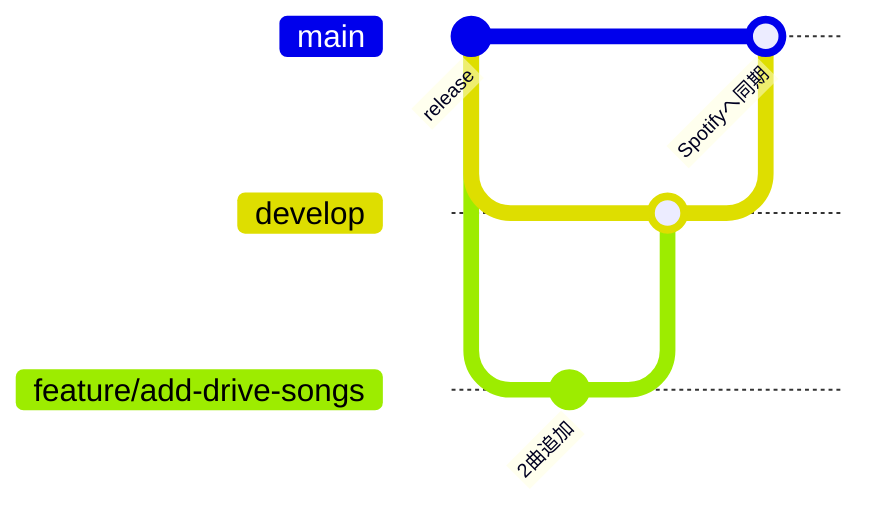

# コントリビュートの方法

[English](./CONTRIBUTING.md) | 日本語

## ブランチ

| ブランチ | 役割 | Spotify |
| --- | --- | --- |
| `main` | 公開中の状態。`develop`（緊急時は `hotfix/*`）だけをマージします。 | マージのたびに同期 |
| `develop` | 統合用ブランチ。曲の提案もコードの変更もまずここに入ります。 | 同期しない |
| `feature/<短い名前>` | 1つの提案・変更ごとに `develop` から作ります。 | 同期しない |
| `hotfix/<短い名前>` | `main` から作る緊急修正。マージ後に `develop` にも取り込みます。 | マージ時に同期 |

## 曲の追加・コードの変更

1. `develop` から分岐します：`git switch develop && git pull && git switch -c feature/<短い名前>`
2. 変更します。曲なら `playlists/` のファイルに1曲1行で追記します（README 参照）。
3. `develop` 向けにプルリクを作ります。検証ワークフローがファイルをチェックし、追加・削除された曲を一覧にします。
4. レビューする人が聴いて承認し、マージします。

## Spotify への反映（リリース）

`develop` から `main` へのプルリクを作ります。マージされると同期ワークフローが Spotify のプレイリストを更新します。`develop` 以外のブランチから `main` へのプルリクは `source-branch` チェックで失敗します。
