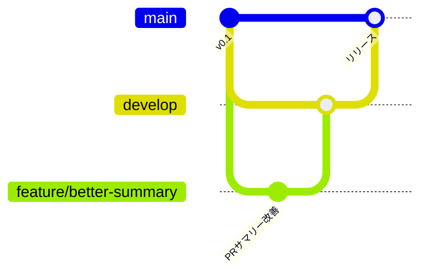

# コントリビュートの方法

[English](./CONTRIBUTING.md) | 日本語

このページはこのリポジトリでツール自体を開発するときの説明です。自分たちの共同プレイリストを運用したい場合は、`main` からコピーを作ってください（README のセットアップを参照）。

## ブランチ

| ブランチ | 役割 |
| --- | --- |
| `main` | 公開中のリリース版。みんなはここからコピーして使います。`develop`（緊急時は `hotfix/*`）だけをマージします。 |
| `develop` | 次のリリースに向けた統合用ブランチ。 |
| `feature/<短い名前>` | 1つの変更ごとに `develop` から作り、プルリクで戻します。 |
| `hotfix/<短い名前>` | `main` から作る緊急修正。マージ後に `develop` にも取り込みます。 |

## 変更の手順

1. `git switch develop && git pull && git switch -c feature/<短い名前>`
2. 変更して `python -m unittest` と `python -m pac validate` を実行します。
3. `develop` 向けにプルリクを作ります。CI がテストとプレイリストのチェックを実行します。

## リリース

リリース前に `CHANGELOG.md` の `[Unreleased]` を新しいバージョンの見出しに移し、`pac/__version__` を上げます。そのうえで `develop` から `main` へのプルリクを作り、マージ後にそのコミットへタグ（`vX.Y.Z`）を付けて、同じ内容で GitHub Release を公開します。このリポジトリでは、`develop` 以外から `main` へのプルリクは `source-branch` チェックで失敗します。テンプレートから作ったコピーではこのチェックは動かないので、曲の提案をそのまま `main` にマージできます。
