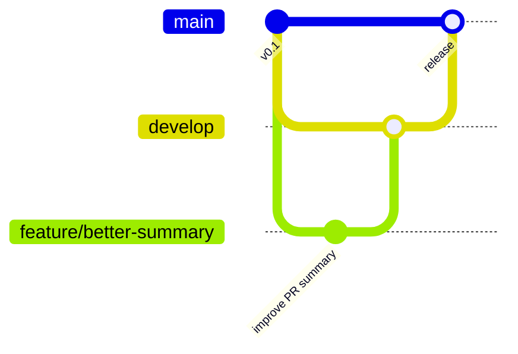

# Contributing

English | [日本語](./CONTRIBUTING.ja.md)

This page is about developing the tool in this repository. To run your own shared playlist, make a copy from `main` instead (see the README's Setup section).

## Branches

| Branch | Purpose |
| --- | --- |
| `main` | Released version that people copy and use. Only `develop` (or an urgent `hotfix/*`) is merged here. |
| `develop` | Integration branch for the next release. |
| `feature/<short-name>` | One change, branched from `develop`, merged back by pull request. |
| `hotfix/<short-name>` | Urgent fix branched from `main`; merge it into `develop` too afterwards. |

## Making a change

1. `git switch develop && git pull && git switch -c feature/<short-name>`
2. Make the change and run `python -m unittest` and `python -m pac validate`.
3. Open a pull request into `develop`. CI runs the tests and runs this branch's action (`uses: ./`) against the sample playlists.

## Releasing

Before releasing, move the `[Unreleased]` notes in `CHANGELOG.md` under a new version heading and bump `pac/__version__`. Then open a pull request from `develop` into `main`, and after it is merged, publish a GitHub Release with a new `vX.Y.Z` tag on `main` and the same notes. The *Move the major version tag* workflow then points `vX` at the release, which is what copies using `@vX` pick up. Publish right after merging, since new copies of `main` call `@vX`. In this repository, pull requests into `main` from any other branch fail the `source-branch` check. Copies made from the template skip that check, so they can merge song proposals straight into `main`.
