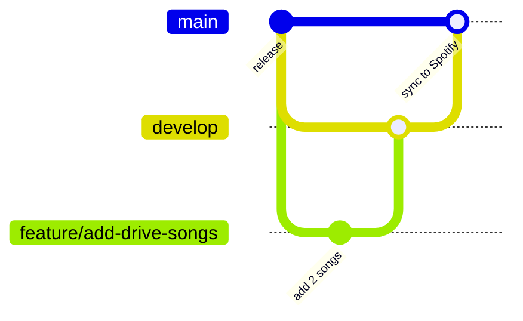

# Contributing

English | [日本語](./CONTRIBUTING.ja.md)

## Branches

| Branch | Purpose | Spotify |
| --- | --- | --- |
| `main` | What is live. Only `develop` (or an urgent `hotfix/*`) is merged here. | Synced on every merge |
| `develop` | Integration branch. Song proposals and code changes land here first. | Not synced |
| `feature/<short-name>` | One proposal or change, branched from `develop`. | Not synced |
| `hotfix/<short-name>` | Urgent fix branched from `main`; merge back into `develop` afterwards. | Synced when merged |

## Adding songs or changing code

1. Branch from `develop`: `git switch develop && git pull && git switch -c feature/<short-name>`.
2. Make the change. For songs, add one line per track to a file in `playlists/` (see the README).
3. Open a pull request into `develop`. The validate workflow checks the files and lists the added and removed songs.
4. Reviewers listen and approve, then merge.

## Releasing to Spotify

Open a pull request from `develop` into `main`. Once it is merged, the sync workflow updates the Spotify playlists. Pull requests into `main` from any other branch fail the `source-branch` check.
