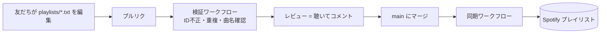

<h1 align="center">🎧 Playlist as Code</h1>

<p align="center">
  Spotify の共同プレイリストを、コードのリポジトリのように運用する仕組みです。<br />
  友だちが曲をプルリクで提案し、聴いてレビューし、<code>main</code> にマージすると本物のプレイリストに反映されます。
</p>

<p align="center">
  <a href="https://github.com/keito118/spotify-playlist-as-code/actions/workflows/validate.yml"></a>
  <a href="./LICENSE"></a>
</p>

<p align="center"><a href="./README.md">English</a> | 日本語</p>

> [!TIP]
> **🎶 みんなでプレイリスト作ろうぜ！**
> このツールで動いている [**Open Source Mixtape**](https://github.com/keito118/open-source-mixtape) には、世界中の誰でも曲を追加できます。好きな曲をプルリクで送って、マージされたら [Spotify のプレイリスト](https://open.spotify.com/playlist/6RrEtS1qX6csamOV6ET74Q)に入ります。準備はいりません、ブラウザだけで OK。気軽にどうぞ！🚀

---

## しくみ



- **1プレイリスト1ファイル、1曲1行。** `playlists/work-bgm.txt`、`playlists/drive.txt` のように分けます。ファイルの並び順がそのまま Spotify の曲順になります。
- **プルリクが提案。** 検証ワークフローが不正な ID や重複を弾き、追加された曲を Spotify で照会して `➕ Rick Astley - Never Gonna Give You Up` のような一覧をジョブサマリーに出します。
- **マージが公開。** `main` に push されるたび、同期ワークフローが各プレイリストをファイルの内容と完全に一致させます。
- **履歴が残る。** `git log -p playlists/drive.txt` で、誰がいつ何をなぜ足したかが分かります。

## 曲の追加方法

### かんたんな方法：Issue にリンクを貼る

1. Spotify で曲のリンクをコピーします（共有 → 曲のリンクをコピー）。
2. 新しい Issue を作り、**🎵 Add a song** を選びます。リンクを貼り、よければ選んだ理由も書きます。
3. bot が Spotify で曲を調べ、プレイリストのファイルに追加して、プルリクを代わりに作ります。Issue にプルリクのリンクが返ってきます。

リンクが間違っている、またはすでに入っている曲の場合は、bot が Issue でそう伝えます。

### ファイルを自分で編集する方法

1. Spotify で曲のリンクをコピーします（共有 → 曲のリンクをコピー）。
2. プレイリストのファイルに1行追加します。レビューする人が分かるようにメモも付けます。

   ```text
   https://open.spotify.com/track/4uLU6hMCjMI75M1A2tKUQC  # Rick Astley - Never Gonna Give You Up
   ```

3. プルリクを作ります。GitHub のブラウザ上のエディタだけで完結します。

書ける形式は `spotify:track:<id>`、`https://open.spotify.com/track/<id>`（`?si=…` 付きでも可）、22文字の ID そのもの、のいずれかです。

## ファイル形式

```text
# @title 作業用BGM
# @playlist 3cEYpjA9oz9GiPac4AsH4n
# "#" で始まるそれ以外の行はコメントです。

spotify:track:11dFghVXANMlKmJXsNCbNl  # Carly Rae Jepsen - Cut To The Feeling
```

| 指定 | 意味 |
| --- | --- |
| `# @playlist <ID または URL>` | 同期先の Spotify プレイリスト。この行がないファイルは検証だけされ、同期されません。 |
| `# @title <名前>` | サマリーに表示する名前。省略時はファイル名です。 |

## 実際に動いている例

[**Open Source Mixtape**](https://github.com/keito118/open-source-mixtape) は、このツールで運用している公開プレイリストです。曲を追加するプルリクを出すと、チェックと同期が実際に動くところを見られます。

## セットアップ

グループごとに自分用のコピーを作って運用します。このリポジトリの `main` はツールのリリース版で、ここに曲を送る使い方はしません。

### 0. 自分用のコピーを作る

このリポジトリの `main` ブランチで **Use this template**（または **Fork**）を押します。コピー先では友だちが `main` 向けにプルリクを出し、マージすると自分の Spotify プレイリストに同期されます。`playlists/` のサンプルは自分のファイルに置き換えてください。

`.github/` にあるワークフローと **🎵 Add a song** の Issue フォームはコピーにそのまま入ります。シークレットとリポジトリの設定は引き継がれないので、手順 3 で設定します。Fork した場合は、**Settings → General → Features** で **Issues** をオンにし、**Actions** タブでワークフローを有効にしてください。Fork ではどちらも最初はオフです。

### 1. Spotify アプリを作る

1. [Spotify Developer Dashboard](https://developer.spotify.com/dashboard) でアプリを作成します（**Web API** を選択）。
2. リダイレクト URI に `http://127.0.0.1:8888/callback` を追加します。
3. **Client ID** と **Client Secret** を控えます。

Spotify の開発モードでは、アプリ所有者が Spotify Premium に加入している必要があります。

### 2. リフレッシュトークンを取得する（自分の PC で）

コピーしたリポジトリを clone したフォルダ（または **Code → Download ZIP** で展開したフォルダ）で実行します。

```bash
python scripts/get_refresh_token.py
```

Spotify の同意画面が開き、リフレッシュトークンが表示されます。このトークンでプレイリストを編集できるので、リポジトリには絶対に入れないでください。

<details>
<summary>うまくいかないとき</summary>

- **macOS で `CERTIFICATE_VERIFY_FAILED`**：python.org から入れた Python は、最初に一度だけ証明書のインストールが必要です。`open "/Applications/Python 3.x/Install Certificates.command"`（3.x は自分のバージョン）を実行してから、もう一度スクリプトを実行してください。
- **`invalid_client: Invalid client secret`**：Secret の入力ミスか、余計な文字が入っています。Dashboard からコピーし直すか、先に `export SPOTIFY_CLIENT_SECRET=...`（macOS/Linux）または `$env:SPOTIFY_CLIENT_SECRET = "..."`（Windows PowerShell）で設定してから実行してください。
- **ブラウザに `INVALID_CLIENT: Invalid redirect URI`**：アプリのリダイレクト URI に `http://127.0.0.1:8888/callback` を一字一句そのまま追加してください。
- **`python` が見つからない**：macOS / Linux では `python3` を使うか、python.org から Python 3.10 以上を入れてください。

</details>

### 3. リポジトリのシークレットを登録する

**Settings → Secrets and variables → Actions → New repository secret** で次の3つを登録します。

| シークレット | 値 |
| --- | --- |
| `SPOTIFY_CLIENT_ID` | 手順1の Client ID |
| `SPOTIFY_CLIENT_SECRET` | 手順1の Client Secret |
| `SPOTIFY_REFRESH_TOKEN` | 手順2の出力 |

シークレットがなくても両方のワークフローは動きます。検証は Spotify への照会を省略し、同期はドライランになります。

**🎵 Add a song** の Issue フォームからプルリクを作れるように、**Settings → Actions → General → Workflow permissions** で **Allow GitHub Actions to create and approve pull requests** をオンにしてください。

### 4. ファイルとプレイリストをひもづける

Spotify でプレイリストを作ってリンクをコピーし、ファイルに `# @playlist https://open.spotify.com/playlist/…` と書きます。マージすると同期ワークフローが曲を入れます。

> [!WARNING]
> 同期はプレイリストの中身をファイルの内容で置き換えます。Spotify アプリから直接追加した曲は、次の同期で消えます。

## ローカルでの実行

```bash
python -m unittest                  # テスト
python -m pac validate              # 全ファイルを検証
python -m pac validate --base main  # main からの差分も表示
python -m pac sync --dry-run        # 同期内容を確認だけする
python -m pac add <曲のリンク> --playlist drive  # ファイルに曲を追加
```

標準ライブラリのみで動きます（Python 3.10 以上）。

## 構成

```text
playlists/              プレイリストごとの .txt
pac/playlist.py         ファイルの解析と検証ルール
pac/spotify.py          最小限の Spotify Web API クライアント (urllib)
pac/add.py, pac/issue.py  Issue フォームからの曲の追加
pac/__main__.py         validate / sync / add コマンド
scripts/                リフレッシュトークン取得スクリプト
.github/workflows/      PR で検証、マージで同期、Issue から曲を追加
.github/ISSUE_TEMPLATE/ 「Add a song」の Issue フォーム
```

## ツールの開発

ツール自体の開発は `develop` と `feature/*` ブランチで行い、`main` にはリリースだけを入れます。詳しくは [CONTRIBUTING.ja.md](./CONTRIBUTING.ja.md) を見てください。

## 補足

- Spotify の [2026年2月の Web API 変更](https://developer.spotify.com/documentation/web-api/references/changes/february-2026) で導入されたプレイリストの `/items` エンドポイントを使っています。
- サンプルの曲は Spotify 公式ドキュメントの例で使われている ID です。

## ライセンス

[MIT](./LICENSE)
