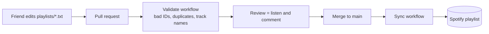

<h1 align="center">🎧 Playlist as Code</h1>

<p align="center">
  A shared Spotify playlist run like a code repository.<br />
  Friends propose songs by pull request, review them by listening, and merging to <code>main</code> updates the real playlist.
</p>

<p align="center">
  <a href="https://github.com/keito118/spotify-playlist-as-code/actions/workflows/validate.yml"></a>
  <a href="./LICENSE"></a>
</p>

<p align="center">English | <a href="./README.ja.md">日本語</a></p>

---

## How it works



- **One file per playlist, one track per line.** `playlists/work-bgm.txt`, `playlists/drive.txt`, and so on. Order in the file is order in Spotify.
- **Pull requests are proposals.** The validate workflow rejects malformed IDs and duplicates, looks up each added track on Spotify, and writes a summary like `➕ Rick Astley - Never Gonna Give You Up` to the job summary.
- **Merging is publishing.** On every push to `main`, the sync workflow makes each Spotify playlist match its file exactly.
- **History is free.** `git log -p playlists/drive.txt` shows who added what, when, and why.

## Adding a song

1. Copy the track link in Spotify (Share → Copy Song Link).
2. Add a line to the playlist file, with a note so reviewers know what it is:

   ```text
   https://open.spotify.com/track/4uLU6hMCjMI75M1A2tKUQC  # Rick Astley - Never Gonna Give You Up
   ```

3. Open a pull request. You can do all of this in the GitHub web editor.

Accepted forms: `spotify:track:<id>`, `https://open.spotify.com/track/<id>` (with or without `?si=…`), or the bare 22-character ID.

## Playlist file format

```text
# @title Work BGM
# @playlist 3cEYpjA9oz9GiPac4AsH4n
# Other lines starting with "#" are comments.

spotify:track:11dFghVXANMlKmJXsNCbNl  # Carly Rae Jepsen - Cut To The Feeling
```

| Directive | Meaning |
| --- | --- |
| `# @playlist <id or URL>` | The Spotify playlist this file syncs to. Files without it are validated but not synced. |
| `# @title <name>` | Display name used in summaries. Defaults to the file name. |

## Setup

Each group runs its own copy. This repository's `main` branch is the released version of the tool; you don't send songs here.

### 0. Make your own copy

Click **Use this template** (or **Fork**) on this repository's `main` branch. In your copy, friends open pull requests into `main`, and merging syncs your Spotify playlists. Replace the sample files in `playlists/` with your own.

### 1. Create a Spotify app

1. Go to the [Spotify Developer Dashboard](https://developer.spotify.com/dashboard) and create an app (select **Web API**).
2. Add the redirect URI `http://127.0.0.1:8888/callback`.
3. Note the **Client ID** and **Client Secret**.

Spotify's development mode requires the app owner to have Spotify Premium.

### 2. Get a refresh token (on your own computer)

In a clone of your copy (or a folder from **Code → Download ZIP**), run:

```bash
python scripts/get_refresh_token.py
```

It opens Spotify's consent page and prints a refresh token. The token can edit your playlists, so keep it out of the repository.

<details>
<summary>Troubleshooting</summary>

- **macOS: `CERTIFICATE_VERIFY_FAILED`.** Python from python.org needs its certificates installed once. Run `open "/Applications/Python 3.x/Install Certificates.command"` (use your version number), then run the script again.
- **`invalid_client: Invalid client secret`.** The secret was mistyped or pasted with extra characters. Copy it again from the dashboard, or set it first with `export SPOTIFY_CLIENT_SECRET=...` (macOS/Linux) or `$env:SPOTIFY_CLIENT_SECRET = "..."` (Windows PowerShell).
- **`INVALID_CLIENT: Invalid redirect URI` in the browser.** Add `http://127.0.0.1:8888/callback` to the app's redirect URIs exactly as written.
- **`python` not found.** Use `python3` on macOS and Linux, or install Python 3.10+ from python.org.

</details>

### 3. Add repository secrets

In **Settings → Secrets and variables → Actions → New repository secret**, add:

| Secret | Value |
| --- | --- |
| `SPOTIFY_CLIENT_ID` | Client ID from step 1 |
| `SPOTIFY_CLIENT_SECRET` | Client Secret from step 1 |
| `SPOTIFY_REFRESH_TOKEN` | Output of step 2 |

Without secrets, both workflows still run: validation skips the online lookup and sync runs as a dry run.

### 4. Point a file at a playlist

Create a playlist in Spotify, copy its link, and put it in the file as `# @playlist https://open.spotify.com/playlist/…`. Merge, and the sync workflow fills it.

> [!WARNING]
> Sync replaces the playlist's contents with the file. Songs added directly in the Spotify app will be removed on the next sync.

## Running locally

```bash
python -m unittest                  # tests
python -m pac validate              # check every playlist file
python -m pac validate --base main  # also show what changed since main
python -m pac sync --dry-run        # show what would be synced
```

Standard library only; Python 3.10 or later.

## Project layout

```text
playlists/              one .txt per playlist
pac/playlist.py         file parser and validation rules
pac/spotify.py          minimal Spotify Web API client (urllib)
pac/__main__.py         `validate` and `sync` commands
scripts/                refresh-token helper
.github/workflows/      validate on PR, sync on merge
```

## Developing the tool

Work on the tool itself happens on `develop` and `feature/*` branches, and `main` only receives releases. See [CONTRIBUTING.md](./CONTRIBUTING.md).

## Notes

- Uses the playlist `/items` endpoints from Spotify's [February 2026 Web API changes](https://developer.spotify.com/documentation/web-api/references/changes/february-2026).
- The sample tracks are the IDs used in Spotify's own documentation examples.

## License

[MIT](./LICENSE)
